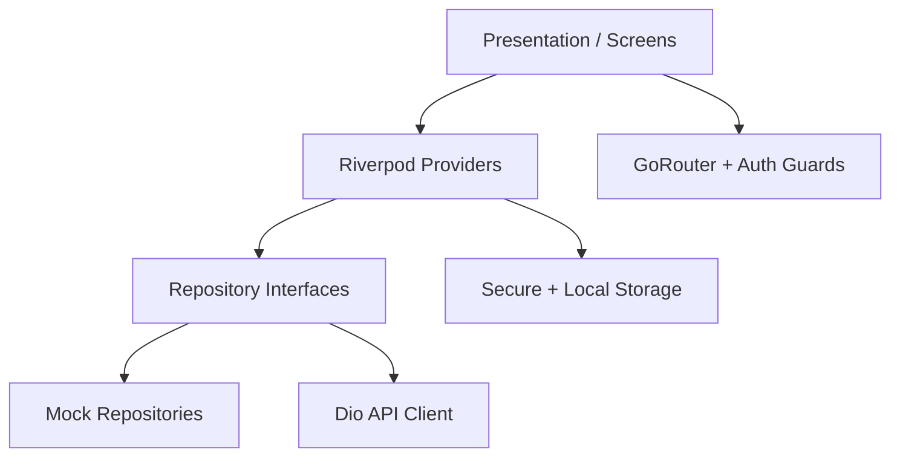

# Servix 3D — Smart On-Demand Services

Portfolio-grade Flutter marketplace for discovering, booking, and tracking home services with a premium Material 3 UI and interactive 3D-style hero.

## Features

- Animated splash + onboarding (persisted)
- Auth: login, register, forgot password, OTP, reset (persisted user + passwords)
- Home dashboard with interactive 3D hero, categories, popular/recommended services, pros, bookings
- Explore, search, filters, service details (Hero transitions)
- Multi-step booking + mocked payment architecture
- Booking tracking with **advance status**, **reschedule**, cancel (persisted locally)
- Provider profiles, reviews, in-app contact messaging
- Favorites, notifications, profile, payment methods, help, privacy, security, about
- Light / Dark / System themes + language preference
- Mock map with Google Maps enablement notes
- Clean Architecture + Riverpod + GoRouter + Dio

## Tech Stack

| Layer | Choice |
| --- | --- |
| UI | Flutter 3.44 · Material 3 · Google Fonts |
| State | Riverpod 3 |
| Navigation | GoRouter |
| Networking | Dio (interceptors, API-ready) |
| Local | Hive · SharedPreferences · Flutter Secure Storage |
| Motion | flutter_animate · CustomPaint 3D hero |

## Architecture



Feature-based folders under `lib/features/*` with `data` / `domain` / `presentation`.

## Run

```bash
cd simple_app
flutter pub get
flutter run -d windows   # or chrome / android
```

**Demo login:** `asad@servix3d.com` / `Servix@123`  
(Any valid email + password ≥ 6 chars also works in mock mode.)

OTP for password reset: `123456`

## Environment

Copy `.env.example` → `.env` (optional; mock mode works without it):

```
API_BASE_URL=https://api.servix3d.example.com/v1
GOOGLE_MAPS_API_KEY=
STRIPE_PUBLISHABLE_KEY=
ENABLE_MOCK_API=true
```

Never commit real secrets.

## 3D Assets

Interactive hero uses Flutter `Transform` / `CustomPaint` (stable on Windows/mobile/web).  
Drop production GLB/GLTF files into `assets/models/` and optionally wire `model_viewer_plus` for mobile/web.

## Testing

```bash
flutter test
flutter analyze --no-fatal-infos --no-fatal-warnings
```

## API Integration

Swap `Mock*Repository` implementations behind existing interfaces (`AuthRepository`, `ServicesRepository`, `BookingsRepository`, `PaymentService`) and point Dio at your backend via `API_BASE_URL`.

## Author

Built as a CV / GitHub / Upwork portfolio showcase for modern Flutter engineering.

## License

MIT — see [LICENSE](LICENSE)
